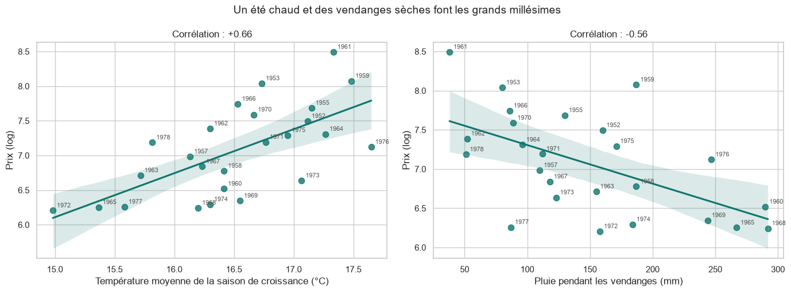
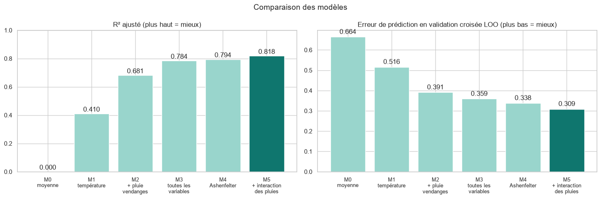
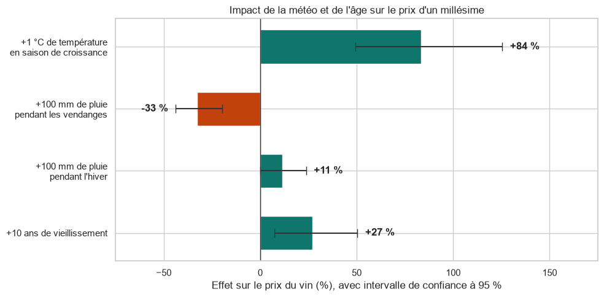
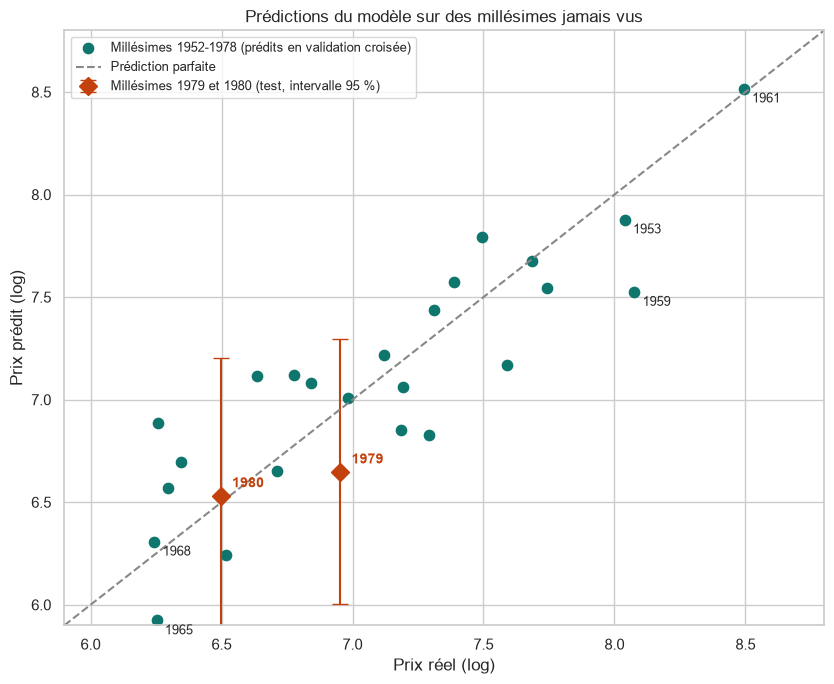
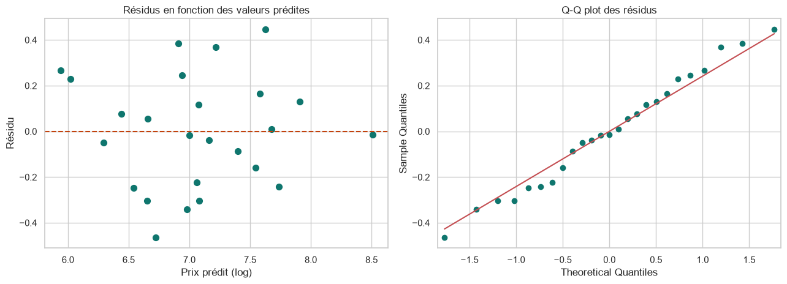

# Prédire la qualité d'un vin de Bordeaux à partir de la météo

Projet de data science : régression linéaire, sélection de modèle par validation croisée et interprétation statistique.
Il reconstruit la célèbre « Bordeaux equation » de l'économiste **Orley Ashenfelter** (1990), qui prédit le prix d'un millésime
**sans le goûter**, uniquement à partir de la météo de l'année de récolte.

👉 **Notebook : [wine_price_prediction.ipynb](wine_price_prediction.ipynb)**

## Résultats clés

- **4 variables** (température, pluie des vendanges, pluie d'hiver, âge) expliquent **83 % de la variance** des prix.
- **+1 °C** pendant la saison de croissance ≈ **+84 % de prix**, et **+100 mm** de pluie aux vendanges ≈ **−33 %**.
- Le meilleur modèle **divise par 2 l'erreur de prédiction** en validation croisée (0,309 contre 0,664 pour la moyenne).
- Les prix réels des millésimes **1979 et 1980**, jamais vus par le modèle, tombent dans les intervalles de prédiction à 95 %.

## Un été chaud et des vendanges sèches font les grands millésimes



## Choisir le modèle par validation croisée, pas par le R²

Avec seulement 25 millésimes, le R² d'apprentissage augmente à chaque variable ajoutée. Les modèles sont donc comparés par
leur **erreur de prédiction en validation croisée leave-one-out** : chaque millésime est prédit par un modèle entraîné sur les 24 autres.
Mettre toutes les variables donne le même R² que l'équation d'Ashenfelter, mais de moins bonnes prédictions.



| Modèle | R² | R² ajusté | Erreur LOO |
| --- | --- | --- | --- |
| Moyenne (référence) | – | – | 0,664 |
| Température | 0,435 | 0,410 | 0,516 |
| + pluie des vendanges | 0,707 | 0,681 | 0,391 |
| Toutes les variables | 0,829 | 0,784 | 0,359 |
| Équation d'Ashenfelter | 0,829 | 0,794 | 0,338 |
| **+ interaction des pluies** | **0,856** | **0,818** | **0,309** |

## Combien vaut un degré de plus ?

`Price` étant le logarithme du prix, chaque coefficient se lit comme un effet en pourcentage sur le prix réel :



## Prédiction de nouveaux millésimes



Le modèle prédit presque parfaitement **1961**, le millésime le plus cher, sans l'avoir vu. Sa plus grosse erreur concerne **1959** :
ses vendanges pluvieuses auraient dû pénaliser son prix, mais le marché l'a jugé exceptionnel.

Les hypothèses du modèle sont vérifiées : normalité des résidus (Shapiro-Wilk, p = 0,84) et homoscédasticité
(Breusch-Pagan, p = 0,69).



## Leçons de méthode

- **Lire la documentation des données** : `Price` est déjà un logarithme. Le reprendre une seconde fois fausserait l'interprétation des coefficients.
- **Comparer les modèles par validation croisée** quand les données sont peu nombreuses.
- **La colinéarité ne gêne pas la prédiction, mais l'interprétation** : `Age` = 1983 − `Year` exactement, et `FrancePop` suit les années
  (VIF ≈ 100). On ne garde qu'une de ces variables.

## Données

25 millésimes de Bordeaux (1952-1978) pour l'apprentissage et 2 millésimes (1979-1980) pour le test, issus des travaux
d'Orley Ashenfelter (*Liquid Assets*), dans la version diffusée par le cours *The Analytics Edge* (MIT).

| Variable | Description |
| --- | --- |
| `Price` | logarithme du prix moyen aux enchères de 1990-1991 |
| `AGST` | température moyenne de la saison de croissance (°C) |
| `HarvestRain` | pluie pendant les vendanges, en août et septembre (mm) |
| `WinterRain` | pluie de l'hiver précédent (mm) |
| `Age` | âge du vin en 1983 (années) |
| `Year`, `FrancePop` | année de récolte, population française (milliers) |

## Lancer le notebook

```bash
pip install -r requirements.txt
jupyter notebook wine_price_prediction.ipynb
```

---

Abibatou WANDAOGO — [Portfolio](https://abibatouwandaogo.github.io/portfolio/projets/statistiques/prix-vin-bordeaux)
